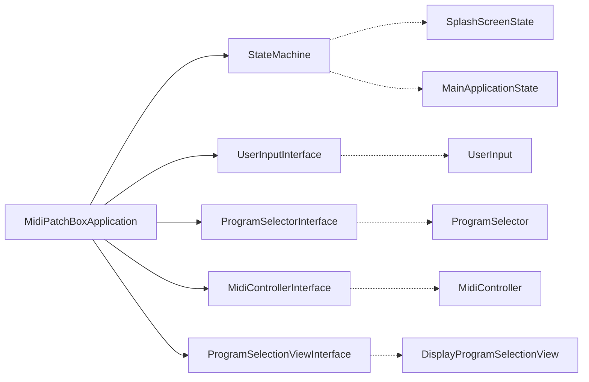
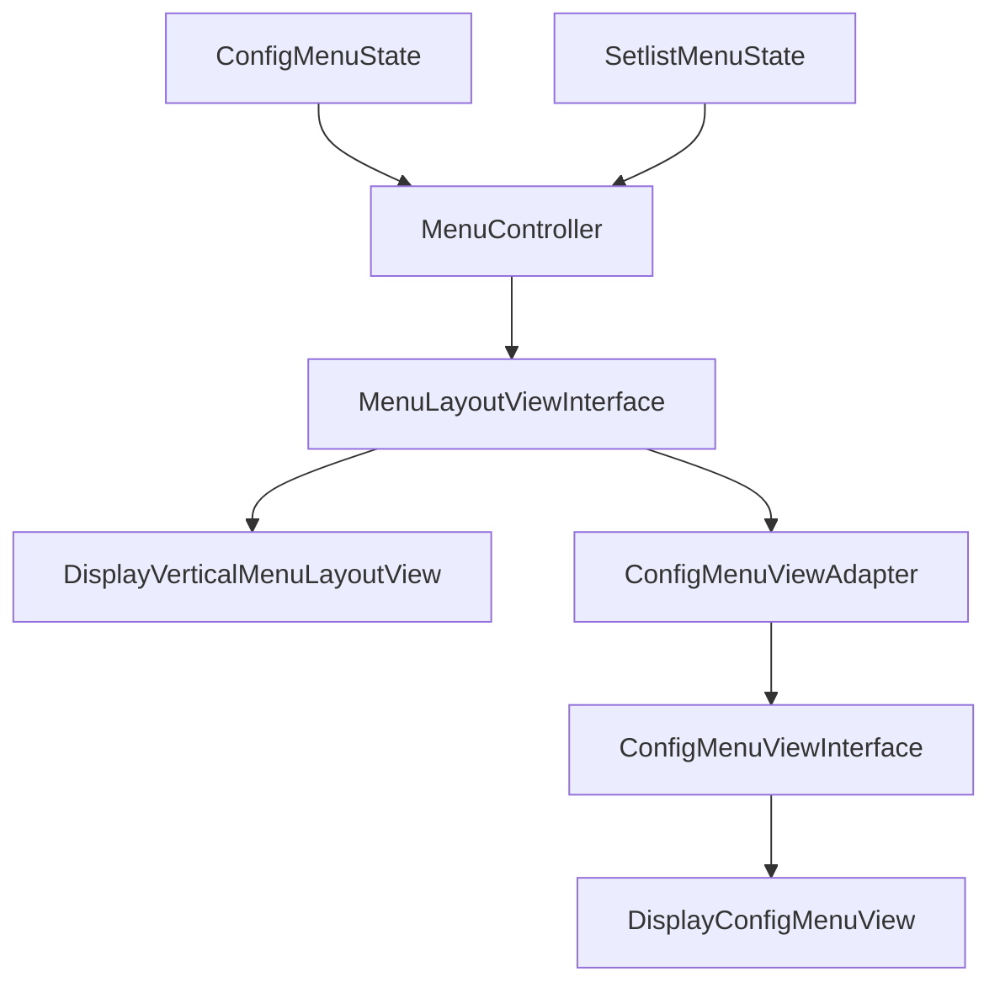
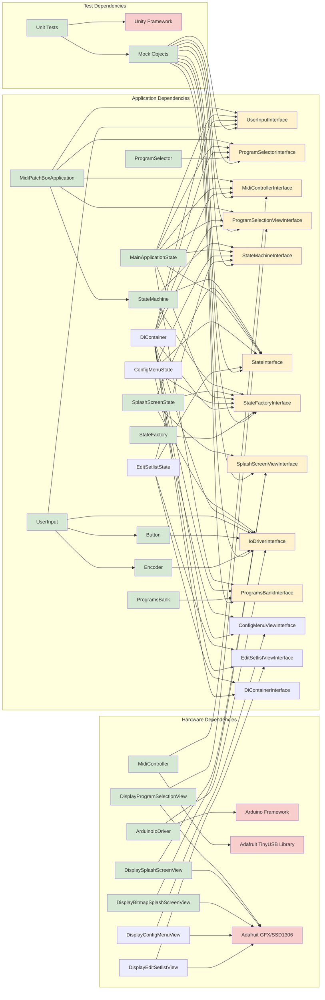
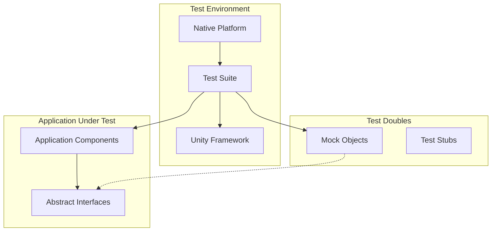

# Architecture

## Overview

MIDI Patch Box is a programmable USB MIDI controller built on the RP2040 microcontroller platform. The project implements a clean, modular architecture with strict separation of concerns, enabling reliable MIDI program selection through hardware buttons and rotary encoder input.

The architecture follows modern C++ design principles with interface-based abstraction, dependency injection, and comprehensive unit testing using the Test-Driven Development (TDD) approach.

## Architectural Principles

### Core Design Principles

- **Interface Segregation**: Each interface defines a single, focused responsibility
- **Dependency Inversion**: Application layer depends on abstractions, not concrete implementations
- **Single Responsibility**: Each class has one clear purpose and reason to change
- **Test-Driven Development**: Business logic is developed test-first with comprehensive coverage
- **Fluent Interface**: Method chaining for intuitive configuration (`setUserInput()->setProgramSelector()`)

### Key Architectural Decisions

1. **Layered Architecture**: Clear separation between application logic, hardware drivers, and testing
2. **Interface-Based Design**: All cross-layer communication happens through abstract interfaces
3. **Dependency Injection**: Components receive their dependencies through setter methods
4. **Mock-Based Testing**: Hardware dependencies are mocked for isolated unit testing
5. **State Machine Pattern**: Application flow managed through discrete states with clear transitions
6. **Factory Pattern**: State creation abstracted through factory interfaces for flexible instantiation

## Data Model

The MIDI Patch Box manages several core data structures for program and setlist management:

### ProgramBank
- **`programNumber`**: Integer (0-127) - MIDI program number
- **`programName`**: String[16] - UTF-8 program name (up to 15 characters + null terminator)
- **`bankIndex`**: Integer - Sequential position in bank for display ordering
- **Capacity**: Up to 128 programs per bank

### Setlist
- **`setlistName`**: String[16] - Name of setlist for display
- **`programReferences`**: ProgramBank[] - Ordered list of program references from bank
- **`programOrder`**: Integer[] - Display and navigation order in setlist
- **Purpose**: Performance sets for live shows with curated program selection

### SystemState
- **`activeBank`**: ProgramBank - Currently selected bank
- **`activeSetlist`**: Setlist - Currently selected setlist (or null if in bank mode)
- **`selectedProgram`**: ProgramBank - Currently selected program for MIDI output
- **`operatingMode`**: Enum{Performance, Configuration} - Current user interface mode

### Storage Architecture
- **Target**: Built-in RP2040 flash memory (2MB)
- **Strategy**: Wear-leveling consideration for frequent writes
- **Scope**: Banks, setlists, and application state persistence
- **MVP Status**: Planned feature (see Build Plan)

## System Architecture

```mermaid
graph TD
    subgraph "Application Layer (src/app/)"
        APP[MidiPatchBoxApplication]
        SM[StateMachine]
        SPS[SplashScreenState]
        MAS[MainApplicationState]
        CMS[ConfigMenuState]
        ESS[EditSetlistState]
        PS[ProgramSelector]
        PB[ProgramsBank]
        BTN[Button]
        ENC[Encoder]
        UI[UserInput]
        SF[StateFactory]
        DC[DiContainer]
        
        subgraph "Interfaces"
            UII[UserInputInterface]
            PSI[ProgramSelectorInterface]
            MCI[MidiControllerInterface]
            IOI[IoDriverInterface]
            PSVI[ProgramSelectionViewInterface]
            SSVI[SplashScreenViewInterface]
            PBI[ProgramsBankInterface]
            SI[StateInterface]
            SMI[StateMachineInterface]
            SFI[StateFactoryInterface]
            EI[EncoderInterface]
            BI[ButtonInterface]
            CMI[ConfigMenuViewInterface]
            ESVI[EditSetlistViewInterface]
            DCI[DiContainerInterface]
        end
    end
    
    subgraph "Hardware Layer (src/hardware/)"
        MC[MidiController]
        AIO[ArduinoIoDriver]
        DPSV[DisplayProgramSelectionView]
        DSSV[DisplaySplashScreenView]
        DBSSV[DisplayBitmapSplashScreenView]
        DCMDV[DisplayConfigMenuView]
        DESV[DisplayEditSetlistView]
    end
    
    subgraph "Test Layer (test/)"
        TESTS[Unit Tests]
        MOCKS[Mock Objects]
    end
    
    APP --> SM
    APP --> UII
    APP --> PSI
    APP --> MCI
    APP --> PSVI
    SM --> SMI
    SM --> SI
    SPS --> SI
    SPS --> SSVI
    SPS --> IOI
    SPS --> SFI
    CMS --> SI
    CMS --> CMI
    CMS --> SFI
    ESS --> SI
    ESS --> ESVI
    ESS --> DCI
    MAS --> SI
    MAS --> UII
    MAS --> PSI
    MAS --> MCI
    MAS --> PSVI
    MAS --> PBI
    UI --> UII
    UI --> BI
    UI --> EI
    BTN --> BI
    BTN --> IOI
    ENC --> EI
    ENC --> IOI
    PS --> PSI
    PB --> PBI
    SF --> SFI
    DC --> DCI
```



## Layers

### Application Layer (`src/app/`)

The application layer contains the core business logic and is designed to be platform-independent. All components in this layer are thoroughly tested using TDD methodology.

**Key Characteristics:**
- Platform-agnostic business logic
- Interface-based communication with hardware
- Comprehensive unit test coverage
- No direct hardware dependencies

**Components:**
- [`MidiPatchBoxApplication`](src/app/MidiPatchBoxApplication.h) - Main application coordinator
- [`StateMachine`](src/app/StateMachine.h) - State management and transitions
- [`SplashScreenState`](src/app/SplashScreenState.h) - Initial application state with splash screen
- [`MainApplicationState`](src/app/MainApplicationState.h) - Main operational state handling user input
- [`ConfigMenuState`](src/app/ConfigMenuState.h) - Configuration menu state for navigation
- [`SetlistMenuState`](src/app/SetlistMenuState.h) - Setlist management and navigation state
- [`EditSetlistState`](src/app/EditSetlistState.h) - Setlist editing state with program selection
- [`ProgramSelector`](src/app/ProgramSelector.h) - Program list management and selection logic
- [`ProgramsBank`](src/app/ProgramsBank.h) - Program name storage and management
- [`UserInput`](src/app/UserInput.h) - User input coordination and button management
- [`Button`](src/app/Button.h) - Button state management with debouncing and long press detection
- [`Encoder`](src/app/Encoder.h) - Rotary encoder input handling
- [`MenuController`](src/app/MenuController.h) - Menu navigation and item management
- [`StateFactory`](src/app/StateFactory.h) - Unified factory for all state creation
- [`DiContainer`](src/app/DiContainer.h) - Dependency injection container
- [`Context`](src/app/Context.h) - Shared data structure for application context
- [`SetlistMenuViewDecorator`](src/app/SetlistMenuViewDecorator.h) - View decorator for setlist menu display
- Abstract interfaces for hardware abstraction and component communication

### Hardware Layer (`src/hardware/`)

The hardware layer provides concrete implementations of the application interfaces, handling direct interaction with the RP2040 hardware and external libraries.

**Key Characteristics:**
- Platform-specific implementations
- Direct hardware interaction
- Implements application layer interfaces
- Manual testing approach

**Components:**
- [`MidiController`](src/hardware/MidiController.h) - USB MIDI communication via Adafruit TinyUSB
- [`ArduinoIoDriver`](src/hardware/ArduinoIoDriver.h) - Arduino-specific I/O operations implementation
- [`DisplayProgramSelectionView`](src/hardware/DisplayProgramSelectionView.h) - Visual program selection feedback via display
- [`DisplaySplashScreenView`](src/hardware/DisplaySplashScreenView.h) - Text-based splash screen display
- [`DisplayBitmapSplashScreenView`](src/hardware/DisplayBitmapSplashScreenView.h) - Bitmap-based splash screen display
- [`DisplayConfigMenuView`](src/hardware/DisplayConfigMenuView.h) - Configuration menu display implementation
- [`DisplayEditSetlistView`](src/hardware/DisplayEditSetlistView.h) - Setlist editing view implementation
- [`DisplayVerticalMenuLayoutView`](src/hardware/DisplayVerticalMenuLayoutView.h) - Vertical menu layout display for setlists and configuration

### Test Layer (`test/`)

The test layer provides comprehensive unit testing infrastructure with mock objects for hardware abstraction.

**Key Characteristics:**
- Unity framework-based testing
- Mock objects for hardware isolation
- Centralized mock management
- TDD workflow support

**Structure:**
- `test/mocks/` - Centralized mock object definitions ([`MockIoDriver`](test/mocks/MockIoDriver.h), [`MockButton`](test/mocks/MockButton.h), [`MockEncoder`](test/mocks/MockEncoder.h))
- `test/test_*/` - Component-specific test suites (application, state_machine, splash_screen_state, main_application_state, program_selector, programs_bank, button, encoder, user_input)
- Native platform execution for fast feedback

## Core Components

### MidiPatchBoxApplication

**Purpose**: Main application coordinator that orchestrates all system components and handles the primary application loop.

**Interfaces Used**:
- [`UserInputInterface`](src/app/UserInputInterface.h) - For reading button states
- [`ProgramSelectorInterface`](src/app/ProgramSelectorInterface.h) - For program management
- [`MidiControllerInterface`](src/app/MidiControllerInterface.h) - For MIDI communication
- [`ProgramSelectionViewInterface`](src/app/ProgramSelectionViewInterface.h) - For displaying program selection
- [`StateMachine`](src/app/StateMachine.h) - For application state management

**Key Responsibilities**:
- Coordinate component interactions through dependency injection
- Manage application lifecycle (begin/tick)
- Provide centralized component access

**Dependencies**: Receives all dependencies through fluent setter methods

**Testing**: Comprehensive unit tests with mocked dependencies



### ProgramSelector

**Purpose**: Manages the list of MIDI programs and handles program selection logic with wrap-around behavior.

**Interface**: Implements [`ProgramSelectorInterface`](src/app/ProgramSelectorInterface.h)

**Key Features**:
- Dynamic program list configuration
- Circular program selection (wraps to first after last)
- Memory management for program arrays
- Fluent interface for configuration

**Dependencies**: None (self-contained business logic)

**Testing**: Extensive unit tests covering all selection scenarios

### Button

**Purpose**: Provides debounced button state management with configurable timing thresholds and long press detection.

**Interface**: Implements [`ButtonInterface`](src/app/ButtonInterface.h)

**Interface Used**: [`IoDriverInterface`](src/app/IoDriverInterface.h) - For GPIO operations

**Key Features**:
- 300ms debounce threshold
- 2-second long press detection
- State change detection
- Hardware abstraction through IoDriver
- Time-based debouncing logic

**Dependencies**: Requires IoDriverInterface implementation

**Testing**: Unit tested with MockIoDriver for time and state simulation

### UserInput

**Purpose**: Application-layer component that coordinates user input from buttons and encoder through interface abstraction.

**Interface**: Implements [`UserInputInterface`](src/app/UserInputInterface.h)

**Key Features**:
- Manages multiple button inputs (user button, right button, encoder button)
- Manages rotary encoder input
- Hardware abstraction through interface dependencies
- Configurable with ready-made control element instances
- Long press detection support (2 seconds)

**Dependencies**: [`ButtonInterface`](src/app/ButtonInterface.h), [`EncoderInterface`](src/app/EncoderInterface.h)

**Testing**: Comprehensive unit tests with [`MockButton`](test/mocks/MockButton.h) and [`MockEncoder`](test/mocks/MockEncoder.h)

### StateMachine

**Purpose**: Manages application states and handles transitions between different operational modes.

**Interface**: Implements [`StateMachineInterface`](src/app/StateMachineInterface.h)

**Key Features**:
- State lifecycle management (enter/update/exit)
- Automatic state cleanup and memory management
- Template-based state transitions
- State machine reference injection into states

**Dependencies**: Manages [`StateInterface`](src/app/StateInterface.h) implementations

**Testing**: Unit tested with mock states for transition verification

### SplashScreenState

**Purpose**: Initial application state that displays splash screen for a configured duration before transitioning to main application.

**Interface**: Implements [`StateInterface`](src/app/StateInterface.h)

**Key Features**:
- 2-second splash screen duration
- Automatic transition to [`MainApplicationState`](src/app/MainApplicationState.h)
- Factory-based state creation
- Display abstraction through [`SplashScreenViewInterface`](src/app/SplashScreenViewInterface.h)

**Dependencies**: [`SplashScreenViewInterface`](src/app/SplashScreenViewInterface.h), [`IoDriverInterface`](src/app/IoDriverInterface.h), [`StateFactoryInterface`](src/app/StateFactoryInterface.h)

**Testing**: Unit tested with mock dependencies and time simulation

### MainApplicationState

**Purpose**: Primary operational state handling user input, program selection, and MIDI communication.

**Interface**: Implements [`StateInterface`](src/app/StateInterface.h)

**Key Features**:
- User input processing (buttons and encoder)
- Program selection logic with encoder rotation
- MIDI program change transmission
- Display updates for program selection
- Integration with [`ProgramsBank`](src/app/ProgramsBank.h) for program names
- Long press detection for menu access (2 seconds)

**Dependencies**: [`UserInputInterface`](src/app/UserInputInterface.h), [`ProgramSelectorInterface`](src/app/ProgramSelectorInterface.h), [`MidiControllerInterface`](src/app/MidiControllerInterface.h), [`ProgramSelectionViewInterface`](src/app/ProgramSelectionViewInterface.h), [`ProgramsBankInterface`](src/app/ProgramsBankInterface.h), [`StateFactoryInterface`](src/app/StateFactoryInterface.h), [`StateMachineInterface`](src/app/StateMachineInterface.h)

**Testing**: Comprehensive unit tests with mocked dependencies

### ConfigMenuState

**Purpose**: Configuration menu state providing navigation between main application and setlist editing using the unified MenuController pattern.

**Interface**: Implements [`StateInterface`](src/app/StateInterface.h)

**Architecture**: Uses **MenuController** mediator pattern for consistent menu behavior

**Key Features**:
- Menu navigation through MenuController delegation
- Encoder rotation handled by MenuController (selectNext/selectPrevious)
- Encoder button press executes selected menu action
- Transitions to [`EditSetlistState`](src/app/EditSetlistState.h) or [`MainApplicationState`](src/app/MainApplicationState.h)
- Display abstraction through [`MenuLayoutViewInterface`](src/app/MenuLayoutViewInterface.h) (via MenuController)
- Menu items configured with lambda actions

**Dependencies**: 
- [`MenuControllerInterface`](src/app/MenuControllerInterface.h) - Menu management and navigation
- [`StateFactoryInterface`](src/app/StateFactoryInterface.h) - State creation for transitions
- [`StateMachineInterface`](src/app/StateMachineInterface.h) - State transitions
- [`UserInputInterface`](src/app/UserInputInterface.h) - Encoder and button input
- [`DiContainerInterface`](src/app/DiContainerInterface.h) - Dependency access

**Pattern**: Navigation menu using MenuController (see [Menu Architecture](#menu-architecture-unified-pattern))

**Testing**: Unit tested with mock MenuController and dependencies

### EditSetlistState

**Purpose**: Setlist editing state allowing users to modify program assignments with dual-mode (navigation + editing) interaction.

**Interface**: Implements [`StateInterface`](src/app/StateInterface.h)

**Architecture**: Uses **specialized editing pattern** with direct state management (does not use MenuController)

**Key Features**:
- **Dual operation modes**: Navigation mode and Edit mode
- **Navigation mode**: Select programs in setlist with encoder rotation
- **Edit mode**: Modify program number (0-127 with wraparound) for selected slot
- **Visual feedback**: Blinking cursor during edit mode
- **Real-time display**: Program names from ProgramsBank update immediately
- **Automatic update**: ProgramSelector receives changes when programs are modified
- **Clean separation**: Input handling and business logic clearly separated

**Dependencies**: 
- [`EditSetlistViewInterface`](src/app/EditSetlistViewInterface.h) - Specialized editing view with blinking cursor support
- [`DiContainerInterface`](src/app/DiContainerInterface.h) - Access to ProgramsBank and other services
- [`StateMachineInterface`](src/app/StateMachineInterface.h) - State transitions
- [`UserInputInterface`](src/app/UserInputInterface.h) - Encoder and button input

**Pattern**: Specialized editing state (see [Menu Architecture - Editing States](#2-editing-states-specialized-implementation))

**Exclusion from MenuController**: EditSetlistState implements a complex editing workflow fundamentally different from navigation menus. See [ADR-002](blueprint/context/cooperative/step7_editsetlist_exclusion_rationale.md) for detailed rationale.

**Testing**: Unit tested with mock dependencies and dual-mode behavior verification

### DiContainer

**Purpose**: Centralized dependency injection container managing all application dependencies.

**Interface**: Implements [`DiContainerInterface`](src/app/DiContainerInterface.h)

**Key Features**:
- Centralized dependency management
- Fluent interface for configuration
- Access to all application services
- State factory integration
- Clean separation of dependency configuration

**Dependencies**: All application interfaces

**Testing**: Unit tested through dependency access verification

### ProgramsBank

**Purpose**: Manages program names and provides lookup functionality for MIDI program numbers.

**Interface**: Implements [`ProgramsBankInterface`](src/app/ProgramsBankInterface.h)

**Key Features**:
- Program name storage (up to 128 programs)
- Fluent interface for program addition
- Name lookup by program number
- Memory-efficient storage with fixed-size names (16 characters)

**Dependencies**: None (self-contained data structure)

**Testing**: Unit tested for storage and retrieval operations

### Encoder

**Purpose**: Handles rotary encoder input with proper state tracking and rotation detection.

**Interface**: Implements [`EncoderInterface`](src/app/EncoderInterface.h)

**Key Features**:
- Dual-pin encoder reading (A and B phases)
- Clockwise and counter-clockwise rotation detection
- State change tracking with proper debouncing
- Hardware abstraction through [`IoDriverInterface`](src/app/IoDriverInterface.h)

**Dependencies**: [`IoDriverInterface`](src/app/IoDriverInterface.h)

**Testing**: Unit tested with [`MockIoDriver`](test/mocks/MockIoDriver.h) for rotation simulation

### MidiController

**Purpose**: Handles USB MIDI communication using the Adafruit TinyUSB library for program change messages.

**Interface**: Implements [`MidiControllerInterface`](src/app/MidiControllerInterface.h)

**Key Features**:
- USB MIDI device functionality
- Program change message transmission
- Configurable MIDI channel support
- USB device descriptor management

**Dependencies**: Adafruit TinyUSB Library

**Testing**: Manual testing with MIDI monitoring tools

### ArduinoIoDriver

**Purpose**: Provides Arduino-specific implementation of I/O operations for hardware abstraction.

**Interface**: Implements [`IoDriverInterface`](src/app/IoDriverInterface.h)

**Key Features**:
- Direct Arduino API mapping (digitalRead, pinMode, delay, millis)
- Pin mode configuration support
- Time-based operations for debouncing
- Hardware abstraction for cross-platform testing

**Dependencies**: Arduino Framework

**Testing**: Abstracted through [`MockIoDriver`](test/mocks/MockIoDriver.h) for unit tests

### DisplayProgramSelectionView

**Purpose**: Provides visual feedback for program selection through display output, enabling users to see the currently selected program number.

**Interface**: Implements [`ProgramSelectionViewInterface`](src/app/ProgramSelectionViewInterface.h)

**Key Features**:
- Real-time program number display updates
- OLED display integration support
- Fluent interface for method chaining
- Hardware abstraction for different display types

**Dependencies**: Display hardware libraries (OLED, LCD, etc.)

**Testing**: Unit tested through [`MockProgramSelectionView`](test/mocks/MockProgramSelectionView.h)

## Design Patterns

### State Machine Pattern

The application uses a finite state machine to manage different operational modes with clear state transitions and lifecycle management. The application includes four main states:

1. **SplashScreenState** - Initial splash screen display
2. **MainApplicationState** - Main operational state for program selection
3. **ConfigMenuState** - Configuration menu for navigation
4. **EditSetlistState** - Setlist editing interface

```cpp
class StateMachine : public StateMachineInterface {
private:
    StateInterface* currentState = nullptr;

public:
    void changeState(StateInterface* newState) override {
        if (currentState) {
            currentState->exit();
            delete currentState;
        }
        currentState = newState;
        if (currentState) {
            currentState->setStateMachine(this);
            currentState->enter();
        }
    }
    
    void update() override {
        if (currentState) {
            currentState->update();
        }
    }
};
```

**State Transitions:**
- SplashScreenState → MainApplicationState (after timeout)
- MainApplicationState → ConfigMenuState (on long press)
- ConfigMenuState → EditSetlistState (on "Edit Setlist" selection)
- ConfigMenuState → MainApplicationState (on "Back" selection)
- EditSetlistState → ConfigMenuState (implicit)

**Key Benefits**:
- Clear separation of application modes
- Automatic state lifecycle management
- Memory safety with RAII principles
- Testable state transitions
- Clean code principles (early returns, isolated conditions)

### Menu Architecture (Unified Pattern)

The application uses a **unified MenuController pattern** for all navigation menus, providing consistent behavior and maintainability. This architecture separates menu states into two categories:

#### 1. Navigation Menus (Use MenuController)

**Pattern**: States delegate menu management to **MenuController** mediator

**States Using This Pattern**:
- [`ConfigMenuState`](src/app/ConfigMenuState.h) - Configuration menu navigation
- [`SetlistMenuState`](src/app/SetlistMenuState.h) - Setlist selection menu

**Architecture**:



**MenuController Responsibilities**:
- Manage menu items and navigation state
- Handle encoder rotation (up/down navigation)
- Track highlighted item with viewport scrolling
- Delegate rendering to MenuLayoutViewInterface
- Execute actions on menu item selection
- Support wrap-around navigation
- Handle menu title display

**State Responsibilities**:
- Define menu items and their actions
- Respond to encoder button press (execute selected action)
- Transition to other states based on actions
- Provide business logic for menu operations

**Key Interfaces**:

```cpp
// MenuController uses this interface for rendering
class MenuLayoutViewInterface {
public:
    virtual void displayTitle(char* title) = 0;
    virtual void displayItem(int index, char* caption, bool highlighted) = 0;
    virtual void clearItems() = 0;
    virtual unsigned int getMaxItems() const = 0;
};

// MenuController interface for states
class MenuControllerInterface {
public:
    virtual void addItem(const char* caption, std::function<void()> action) = 0;
    virtual void selectNext() = 0;
    virtual void selectPrevious() = 0;
    virtual void executeSelectedAction() = 0;
    virtual void resetMenuItems() = 0;
    virtual void setMenuTitle(const char* title) = 0;
};
```

**Benefits of MenuController Pattern**:
- ✅ Consistent navigation behavior across all menus
- ✅ Simplified state implementation (states focus on business logic)
- ✅ Centralized navigation logic (easier to maintain and test)
- ✅ Reusable menu infrastructure
- ✅ Viewport scrolling handled automatically
- ✅ Wrap-around navigation included

**Example: ConfigMenuState**:

```cpp
void ConfigMenuState::enter() {
    auto menuController = diContainer->getConfigMenuController();
    menuController->resetMenuItems();
    menuController->setMenuTitle("Configuration");
    
    menuController->addItem("Edit Setlist", [this]() {
        // Transition to EditSetlistState
        StateInterface* newState = stateFactory->createEditSetlistState();
        stateMachine->changeState(newState);
    });
    
    menuController->addItem("Back", [this]() {
        // Return to MainApplicationState
        StateInterface* newState = stateFactory->createMainApplicationState();
        stateMachine->changeState(newState);
    });
}

void ConfigMenuState::update() {
    userInput->update();
    
    if (userInput->encoderRotatedClockwise()) {
        menuController->selectNext();
    } else if (userInput->encoderRotatedCounterClockwise()) {
        menuController->selectPrevious();
    } else if (userInput->encoderButtonPressed()) {
        menuController->executeSelectedAction();
    }
}
```

**Adapter Pattern for Interface Compatibility**:

Some views implement **ConfigMenuViewInterface** (legacy interface) rather than **MenuLayoutViewInterface**. The **ConfigMenuViewAdapter** bridges this gap:

```cpp
class ConfigMenuViewAdapter : public MenuLayoutViewInterface {
private:
    ConfigMenuViewInterface* wrappedView;
    int lastHighlightedIndex = -1;
    
public:
    void displayItem(int index, char* caption, bool highlighted) override {
        wrappedView->displayMenuItem(index, caption);
        if (highlighted) {
            wrappedView->setSelectedItem(index);
            lastHighlightedIndex = index;
        }
    }
    // ... other method translations
};
```

**Dependency Injection**:

Each navigation menu state receives its own **MenuController** instance through the DI container:

```cpp
class DiContainer : public DiContainerInterface {
private:
    MenuControllerInterface* configMenuController = nullptr;
    MenuControllerInterface* setlistMenuController = nullptr;

public:
    MenuControllerInterface* getConfigMenuController() const override {
        return configMenuController;
    }
    
    MenuControllerInterface* getSetlistMenuController() const override {
        return setlistMenuController;
    }
};
```

**Separation Rationale**: Separate instances prevent state pollution and allow independent configuration.

#### 2. Editing States (Specialized Implementation)

**Pattern**: States manage complex dual-mode interactions directly

**States Using This Pattern**:
- [`EditSetlistState`](src/app/EditSetlistState.h) - Setlist program editing

**Why Not MenuController?**

EditSetlistState implements a **fundamentally different interaction pattern**:

| Navigation Menus | EditSetlistState |
|-----------------|------------------|
| Single mode (navigation) | Dual mode (navigation + editing) |
| Browse and select | Browse, enter edit, modify value, save |
| Simple highlighting | Blinking cursor for edit mode |
| Read-only display | Mutable data (program numbers 0-127) |
| Action execution on selection | Real-time value editing |

**EditSetlistState Architecture**:

```cpp
class EditSetlistState : public StateInterface {
private:
    bool isEditMode;  // Dual-mode tracking
    int selectedIndex;  // Navigation mode
    int editedProgramNumber;  // Edit mode
    Program currentSetlist[16];  // Mutable data
    
    void handleNavigationModeInput();  // Browse setlist
    void handleEditModeInput();  // Edit program number
    void enterEditMode();  // Toggle blinking cursor
    void saveEditedProgram();  // Persist changes
};
```

**EditSetlistViewInterface** (Specialized):

```cpp
class EditSetlistViewInterface {
public:
    virtual void showSetlist(Program* setlist) = 0;
    virtual void setSelectedItemIndex(int index) = 0;
    virtual void setEditMode(bool enabled) = 0;  // Blinking cursor
    virtual void setEditedProgramIndex(int index) = 0;
    virtual void setEditedProgramNumber(int programNumber) = 0;  // Real-time update
    virtual void setEditedProgramName(const char* name) = 0;
};
```

**Key Distinction**: EditSetlistState requires **editing workflow** support that MenuController doesn't provide. Forcing it into MenuController would compromise both abstractions.

**Architectural Decision Record (ADR-002)**: See [`step7_editsetlist_exclusion_rationale.md`](blueprint/context/cooperative/step7_editsetlist_exclusion_rationale.md) for detailed analysis.

#### When to Use Which Pattern

**Use MenuController when**:
- ✅ Single-mode navigation (browse and select)
- ✅ Executing actions on selection
- ✅ Simple menu structure with static or dynamic items
- ✅ Consistent navigation behavior desired

**Use Specialized State when**:
- ✅ Dual-mode or multi-mode interaction required
- ✅ Real-time data editing with immediate feedback
- ✅ Complex visual feedback (blinking, custom rendering)
- ✅ Stateful editing workflow (edit → modify → save/cancel)

### Factory Pattern

State creation is abstracted through a unified factory interface, enabling flexible state instantiation and dependency injection.

```cpp
class StateFactory : public StateFactoryInterface {
private:
    DiContainerInterface* diContainer;

public:
    StateInterface* createSplashScreenState() override {
        return new SplashScreenState(diContainer);
    }

    StateInterface* createMainApplicationState() override {
        return new MainApplicationState(diContainer);
    }

    StateInterface* createConfigMenuState() override {
        return new ConfigMenuState(diContainer);
    }

    StateInterface* createEditSetlistState() override {
        return new EditSetlistState(diContainer);
    }
};
```

**Key Benefits**:
- Centralized state creation logic
- Dependency injection at creation time
- Easy testing with mock factories
- Flexible state configuration

### Dependency Injection

Components receive their dependencies through setter methods, enabling flexible configuration and easy testing.

```cpp
app.setProgramSelector(&programSelector)
    ->setUserInput(&userInput)
    ->setMidiController(&midiController)
    ->begin();
```

### Interface Segregation

Each interface defines a minimal, focused contract:

```cpp
class UserInputInterface {
public:
    virtual void update() = 0;
    virtual bool userButtonIsPressed() = 0;
    virtual bool rightButtonIsPressed() = 0;
    virtual bool encoderRotatedClockwise() = 0;
    virtual bool encoderRotatedCounterClockwise() = 0;
    virtual bool encoderButtonPressed() = 0;
    virtual bool encoderButtonLongPressed() = 0;
};

class ProgramSelectionViewInterface {
public:
    virtual ProgramSelectionViewInterface* setSelectedProgramNumber(int programNumber) = 0;
    virtual ~ProgramSelectionViewInterface() = default;
};

class ConfigMenuViewInterface {
public:
    virtual ConfigMenuViewInterface* setItems(const char** items, int count) = 0;
    virtual ConfigMenuViewInterface* setSelectedIndex(int index) = 0;
    virtual ~ConfigMenuViewInterface() = default;
};

class EditSetlistViewInterface {
public:
    virtual void showSetlist(Program* setlist) = 0;
    virtual void setSelectedItemIndex(int index) = 0;
    virtual void setEditMode(bool enabled) = 0;
    virtual void setEditedProgramIndex(int index) = 0;
    virtual void setEditedProgramNumber(int programNumber) = 0;
    virtual void setEditedProgramName(const char* name) = 0;
    virtual ~EditSetlistViewInterface() = default;
};
```

### Mock Objects

Test doubles provide controlled behavior for unit testing:

```cpp
class MockIoDriver : public IoDriverInterface {
public:
    int digitalRead(int pin) override {
        return pin == BUTTON_PIN ? pinState : LOW;
    }
    // ... controlled test behavior
};
```

### Fluent Interface

Method chaining provides intuitive configuration:

```cpp
app.setProgramSelector(&programSelector)
    ->setUserInput(&userInput)
    ->setMidiController(&midiController)
    ->setProgramSelectionView(&displayView)
    ->begin();
```

## Dependencies



### Dependency Flow

1. **Application Layer**: Depends only on abstract interfaces
2. **Hardware Layer**: Implements interfaces and depends on external libraries
3. **Test Layer**: Uses mock implementations of interfaces for isolation

### External Dependencies

- **Arduino Framework**: RP2040 hardware abstraction and GPIO operations
- **Adafruit TinyUSB Library**: USB MIDI device functionality
- **Unity Framework**: Unit testing infrastructure

## Testing Strategy

### Test-Driven Development (TDD)

The application layer follows strict TDD methodology:

1. **Red**: Write failing test for new functionality
2. **Green**: Implement minimal code to pass the test
3. **Refactor**: Improve code while maintaining test coverage

### Unit Testing Architecture



### Mock Strategy

- **Centralized Mocks**: All mock objects stored in `test/mocks/` directory
- **Interface Compliance**: Mocks implement the same interfaces as real components
- **Controlled Behavior**: Mocks provide predictable, testable behavior
- **State Simulation**: Time and hardware state can be controlled for testing

### Test Organization

```
test/
├── mocks/
│   ├── MockIoDriver.h              # GPIO operations mock
│   ├── MockButton.h                # Button interface mock
│   ├── MockEncoder.h               # Encoder interface mock
│   ├── MockProgramsBank.h          # ProgramsBank interface mock
│   ├── MockProgramSelector.h       # ProgramSelector interface mock
│   ├── MockEditSetlistView.h       # EditSetlistView interface mock
│   └── MockInput.h                 # UserInput interface mock
├── test_button/
│   └── test_button.cpp             # Button logic tests
├── test_encoder/
│   └── test_encoder.cpp            # Encoder logic tests
├── test_program_selector/
│   └── test_program_selector.cpp   # Program selection tests
├── test_programs_bank/
│   └── test_programs_bank.cpp      # Program name storage tests
├── test_user_input/
│   └── test_user_input.cpp         # User input coordination tests
├── test_state_machine/
│   └── test_state_machine.cpp      # State machine tests
├── test_splash_screen_state/
│   └── test_splash_screen_state.cpp # Splash screen state tests
├── test_main_application_state/
│   └── test_main_application_state.cpp # Main application state tests
├── test_splash_screen_view/
│   └── test_splash_screen_view.cpp  # Splash screen view tests
├── test_config_menu_state/
│   └── test_config_menu_state.cpp   # Config menu state tests
├── test_edit_setlist_state/
│   └── test_edit_setlist_state.cpp  # Edit setlist state tests
├── test_state_factory/
│   └── test_state_factory.cpp       # State factory tests
└── test_midi_patch_box_application/
    └── test_midi_patch_box_application.cpp  # Main app tests
```

### Testing Scope

- **Unit Tests**: Application layer components (100% coverage goal)
- **Manual Tests**: Hardware layer functionality and system integration

**Note**: System and integration testing is performed manually due to hardware dependencies and real-time MIDI communication requirements.

## Build and Development

### Code Quality Practices

The project follows Clean Code principles to ensure maintainability and readability:

#### Single Responsibility
Each method performs a single, well-defined task. Complex operations are decomposed into smaller, focused methods with descriptive names.

#### Early Returns
Conditionals use early returns to avoid nested structures:

```cpp
void handleEditModeInput() {
    if (encoderRotatedClockwise()) {
        incrementEditedProgram();
        updateEditedProgramDisplay();
        return;
    }
    
    if (encoderRotatedCounterClockwise()) {
        decrementEditedProgram();
        updateEditedProgramDisplay();
        return;
    }
    
    if (encoderButtonPressed()) {
        saveEditedProgram();
        exitEditMode();
        return;
    }
}
```

#### Isolated Conditions
All boolean checks are encapsulated in descriptive methods:

```cpp
bool encoderRotatedClockwise() {
    auto userInput = diContainer->getUserInput();
    return userInput->encoderRotatedClockwise();
}

bool isInEditMode() const {
    return isEditMode;
}

bool isInNavigationMode() const {
    return !isEditMode;
}
```

#### Abstraction Levels
Methods operate at consistent abstraction levels - high-level methods delegate to lower-level operations:

```cpp
void update() {
    if (isInEditMode()) {
        handleEditModeInput();
        return;
    }
    
    if (isInNavigationMode()) {
        handleNavigationModeInput();
        return;
    }
}
```

#### Inline Simple Delegations
Simple one-liner delegations are inlined to avoid unnecessary indirection:

```cpp
// Instead of:
void handleEditModeButtonPress() {
    saveEditedProgram();
    exitEditMode();
}

// Direct usage:
if (encoderButtonPressed()) {
    saveEditedProgram();
    exitEditMode();
    return;
}
```

### Platform Configuration

**Target Platform**: RP2040 (Raspberry Pi Pico)
- **Framework**: Arduino with Earle Philhower core
- **Build System**: PlatformIO
- **Language Standard**: C++17

**Test Platform**: Native
- **Framework**: Unity
- **Execution**: Local development machine
- **Purpose**: Fast feedback for TDD workflow

### Build Environments

```ini
[env:pico]
platform = https://github.com/maxgerhardt/platform-raspberrypi.git
board = pico
framework = arduino
board_build.core = earlephilhower
lib_deps = adafruit/Adafruit TinyUSB Library
build_flags = -DUSE_TINYUSB

[env:native]
platform = native
build_flags = -std=c++17
test_framework = unity
lib_deps = throwtheswitch/Unity@^2.6.0
test_build_src = yes
build_src_filter = +<app/*>
```

### Development Workflow

1. **TDD Cycle**: Write tests first for application logic
2. **Native Testing**: Run tests on development machine for fast feedback
3. **Hardware Integration**: Test on actual RP2040 hardware
4. **MIDI Validation**: Verify MIDI output with external tools

### Build Commands

```bash
# Run unit tests (fast feedback)
pio test -e native

# Build for hardware
pio run -e pico

# Upload to device
pio run -e pico -t upload

# Clean build
pio run -t clean
```

### Code Organization

- **Header Guards**: All headers use `#pragma once`
- **Interface Naming**: Interfaces end with "Interface" suffix
- **File Structure**: Logical grouping by layer and responsibility
- **Dependency Direction**: Always from concrete to abstract

This architecture ensures maintainable, testable, and extensible code that can evolve with changing requirements while maintaining reliability and performance.